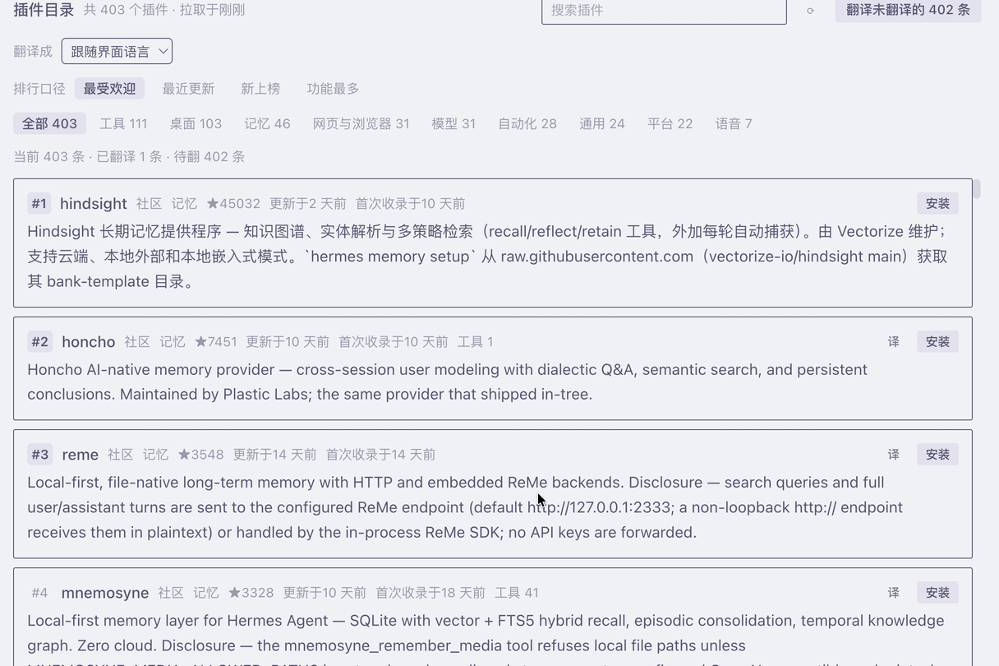

# CN-plugins-market

Browse the [Hermes](https://hermes-agent.nousresearch.com) plugin catalog **inside the Desktop app, in your own language.**

The curated catalog is written in English. This plugin adds a catalog page to Hermes Desktop that ranks it, installs from it, and — the point of the whole thing — **translates each plugin's blurb into the language you choose**, caching the translation so you only ever pay for it once.

> 官方插件目录是英文的。这个插件在 Hermes 桌面端里加一页「插件目录」：四档排行、一键安装，并把每个插件的简介**翻成你选的语言**（主要服务中文用户）——译文按插件缓存，翻过一次就永久复用。

## Features

- **A real ranking.** Sort the catalog by **most starred**, **recently updated**, **newly listed**, or **most capable** (tools + hooks), with the rank number on every card. Ranking, category and target language are compact dropdowns on one line, plus a search box that also matches the translation once you have one.
- **Open a card for the details.** Every card has a `Details` toggle; one card is open at a time, in place, without moving the list. It shows only the fields that exist: version, platforms, maintainer (clickable when there's a GitHub slug), the install command with a copy button, required env vars, tool names (first 8, then `+N`), hook/middleware counts, up to three screenshots, and README / repository / docs links. The catalog's `readme` field is a boolean flag, not text, so the panel links to it instead of inventing a reader. Thumbnails that fail to load hide themselves, and the block disappears entirely if all of them fail — GitHub raw is often unreachable from China.
- **Search in Chinese.** Typing `记忆`, `语音`, `图片`, `代理` and the like used to find almost nothing because only 11 of 800 descriptions contain Chinese. A local synonym table maps 83 Chinese intents onto English catalog keywords, and the search scans name, description, translation, category, tier, maintainer, version, platforms, tools and hooks. No model call, no extra network — with an empty-state hint when nothing matches.
- **One-click install.** Same backend path as the built-in catalog page (`plugins.manage`), so installed state stays in sync across the app.
- **One-click upgrade.** Catalog installs that have moved to a newer pinned revision show an **Update available** badge and an **Update** button; the tooltip shows the installed and catalog revisions side by side. Non-catalog installs are told to use `hermes plugins update <name>` instead of retrying a dead end.
- **Version requirements are visible.** Each card shows the Hermes version an entry needs. When your app is older, the label and the Install button switch to a warning tone and explain that the plugin will be skipped at load, so a silent no-show is no longer a mystery.
- **Enable or disable in place.** Installed entries carry the same on/off switch the built-in Plugins tab drives (`plugins.manage toggle`), so a fresh install is usable without hunting for the official page. Plugins that ship a separate desktop half get a one-click shortcut to that tab instead of a switch — the app owns desktop-plugin decisions and keeps them read-only for plugins, so the shortcut is the honest way to offer it.
- **Know what's installed.** `Installed only` narrows the list to what you actually have — including the parts the catalog alone can't show: Git installs, bundled defaults, and **desktop-only packages that ship no agent half at all** (the agent list alone reports nothing for those, which used to make them look uninstalled). A `Source` control splits your own installs from the built-in defaults, which stay hidden until you ask for them. `Uninstall` (behind a confirm dialog) removes the **whole package** — the agent half and the desktop half, so nothing is left running behind the scenes; a package whose desktop half is present but whose agent half isn't offers `Add its agent half`.
- **Follows the app language**, sidebar entry included: the nav label re-registers itself when you switch languages instead of stranding in the old one.
- **Translate on demand, or in bulk.** `Translate` on a single card, or `Translate N untranslated` to walk the current filter, with progress and a stop button. Bulk runs send **8 entries per model call**, so a 400-entry catalog is minutes, not hours.
- **Pick exactly what you want.** `Select` puts the list into selection mode: every card grows a checkbox, `Select all N shown` respects the current filter, and `Translate N selected` translates only those. The ticks clear themselves when the run finishes.
- **Live progress.** The bulk button carries a spinner, `done/total`, and the name of the plugin being translated right now, so a long run never looks frozen.
- **Cached per language, forever.** Translations are keyed by `<plugin>@<pinned sha>#<language>`, so switching the target language never shows you the previous language's text, and a plugin that updates comes back untranslated rather than showing a stale blurb. Everything else stays free.
- **Target language is yours.** Follows the app language by default (zh → 简体中文, zh-hant → 繁體中文, ja → 日本語, …), or pick from the list.
- **Click the name** to open the plugin's repository in your browser.

## 功能

- **真的排行**：按**最受欢迎 / 最近更新 / 新上榜 / 功能最多**（工具＋钩子）排序，每张卡带名次；排行口径、分类、目标语言都是一个紧凑下拉，跟搜索框一起占一行。
- **卡片能展开看详情**：每张卡多一个「详情」按钮，同一时间只展开一条，就地展开、不打乱滚动位置。只显示真实存在的字段：版本、平台、维护者（有 GitHub slug 就能点进去）、安装命令（带复制按钮）、需要配置的环境变量、工具名（最多 8 个，其余 `+N`）、钩子/中间件数量、最多 3 张截图，以及 README / 仓库 / 文档链接。目录里的 `readme` 只是布尔标记不是正文，所以只给链接；缩略图加载失败会自己隐藏，全失败就整块不显示（GitHub raw 在国内常被墙）。
- **中文检索**：输「记忆」「语音」「图片」「代理」这类词以前几乎搜不到——800 条里只有 11 条简介含中文。现在用一张本地词表把 83 个中文意图映射成英文关键词，检索范围覆盖名称、简介、译文、分类、档位、维护者、版本、平台、工具与钩子；不调模型、不额外联网，搜不到时给一句「试试英文插件名，或先把简介翻译出来再搜」。
- **一键安装**：走和官方目录页同一个后端接口（`plugins.manage`），安装状态全 App 同步。
- **一键升级**：从目录装的条目一旦有新的 pin，就显示「可升级」徽标和「升级」按钮；Tip 里并排给出已装版本和目录最新版的短 SHA。不是从目录装的包不会被反复重试，而是提示改用 `hermes plugins update <名>`。
- **版本门槛看得见**：每张卡标出需要的 Hermes 版本；本机版本偏低时文案和「安装」按钮都变成警示样式，并说明「装了也会在加载时被跳过」，不再出现装了却毫无反应的哑谜。
- **装完能直接用**：已安装的条目带一个**启用/停用开关**（就是官方插件页那个开关，走 `plugins.manage toggle`），不用再跑去官方页找。带**桌面半边**的插件不给开关、给一个**「去开桌面半边」按钮**——桌面插件的开关归 App 自己管（SDK 对插件只读），所以这里只负责一键把你送到「技能与工具 → 插件」。
- **看得见装了什么**：点「只看已安装」把列表收成你已经装的那些——**连目录本身看不到的也列出来**：从 Git 装的、随包内置的，还有**只有桌面半边、压根没有 agent 半边的包**（只问 agent 列表的话它们会被当成"没装"）。旁边的「来源」再把**自己装的**和**官方自带的**分开，内置的默认不出现在列表里。每个已安装的条目带「卸载」（点了先弹确认），**一次删干净整个包**——agent 半边和桌面半边一起删，不会留下还在跑的残留；反过来，桌面半边在、agent 半边不在的包，会多给一个「装 agent 半边」。
- **界面语言跟着 App 走**，侧栏那行也是：切语言时它会重新注册，不会卡在旧语言。
- **单条翻，也能批量翻**：单卡一个「译」；顶上「翻译未翻译的 N 条」按当前筛选往下推，带进度和停止按钮。批量是**一次调用翻译 8 条**，400 条是几分钟的量级。
- **想翻哪几条自己勾**：点「多选」进入选择模式，每张卡左边才出现勾选框；「全选当前 N 条」会跟随当前筛选；「翻译选中的 N 条」只翻这几条。**翻译跑完勾选会自动清空**，不用手动收拾。
- **进度是活的**：批量翻译时按钮上带转轮和 `已完成/总数`，右侧还会显示**正在翻哪一个插件**，跑久了也不会像卡死。
- **译文按语言分别缓存**：key 是 `<插件>@<pin 的 commit>#<语言>`，所以**切换目标语言不会拿旧语言的译文糊弄你**；插件更新了旧译文也会自动作废。其余永远免二次开销。
- **目标语言自选**：默认跟随界面语言（zh → 简体中文，zh-hant → 繁體中文，ja → 日本語……），也可手动指定。
- **点插件名**直接在浏览器里打开它的源码仓库。

## Install

This plugin is **not in the official catalog** — clone it straight into the app's plugin folder. Do not install it through the plugin command: that path copies the desktop half back with a `.hermes-package.json` marker, which switches the plugin off by default, and a desktop-only package has no switch in the app to turn it back on.

```bash
# macOS / Linux
git clone https://github.com/krintcal/CN-plugins-market.git ~/.hermes/desktop-plugins/cn-plugins-market
# Windows (PowerShell) — %USERPROFILE%\.hermes\desktop-plugins\
git clone https://github.com/krintcal/CN-plugins-market.git "$env:USERPROFILE\.hermes\desktop-plugins\cn-plugins-market"
```

Then, in the Desktop app: **⌘K → Reload desktop plugins**. The page appears in the sidebar as **Plugin catalog** (中文界面下显示为「插件目录」).

## 安装

本插件**不在官方目录里**，请直接 clone 进 App 的插件目录。别用插件命令装：那条路会把桌面半边拷回来并盖上 `.hermes-package.json` 标记，一有标记就默认关闭，而纯桌面插件在 App 里没有开关可以打开。

```bash
# macOS / Linux
git clone https://github.com/krintcal/CN-plugins-market.git ~/.hermes/desktop-plugins/cn-plugins-market
# Windows (PowerShell)
git clone https://github.com/krintcal/CN-plugins-market.git "$env:USERPROFILE\.hermes\desktop-plugins\cn-plugins-market"
```

装完在桌面端按 **⌘K → Reload desktop plugins**，左侧导航就会出现「插件目录」。

## Screenshots / 截图



The `screenshots/` folder also fills the gallery on the plugin's catalog page.
`screenshots/` 目录同时会作为插件在官方目录页的图集。

## How it works

- Desktop-only plugin: a single ESM file, `desktop/plugin.js`, using nothing but the public plugin SDK (`@hermes/plugin-sdk`) — it registers one full page (`ROUTES_AREA`) and one sidebar row (`SIDEBAR_NAV_AREA`).
- The catalog is fetched from the same public URL the app itself uses (`plugins.json`), with HTTP caching disabled so re-opening the page always shows the current listing.
- Ranking, search, filters, the translation cache and your last-used sort/language are computed and stored locally (`ctx.storage`).

## Cost & privacy

- Browsing, ranking, searching and installing are **free** and read no credentials.
- The only model call is an explicit translation, one plugin per call, through the gateway's `llm.oneshot` on **whatever provider and model you already have active** — no separate key, no separate bill. Bulk-translating a 400-entry catalog is a fraction of a cent on a cheap model; after that it is cached and free.
- Nothing leaves your machine except the catalog fetch (the same public URL the app fetches) and your own translation calls to your own provider. No telemetry, no self-updater. Opening a repository happens only when you click a plugin name.

## 成本与隐私

- 浏览、排行、搜索、安装**全部免费**，不碰任何凭证。
- 唯一会调模型的动作是「翻译」，一次一条，走网关的 `llm.oneshot`，用的是**你当前已经在用的 provider 和模型**——不用另配密钥，也不会多出一份账单。400 条全翻一遍，在便宜模型上是几毛钱量级；翻完进缓存，之后永久免费。
- 除了抓取那份公开目录（App 自己也在抓的同一个 URL）和你自己发出的翻译请求，什么都不会离开这台机器。没有遥测，没有自更新；打开仓库只在你点插件名时发生。

## Requirements

- Hermes Agent Desktop, `>=0.21.5`.

## License

MIT — see [LICENSE](LICENSE).
